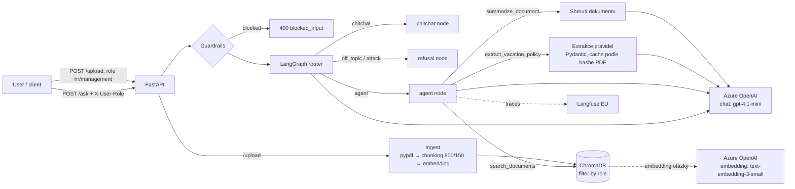
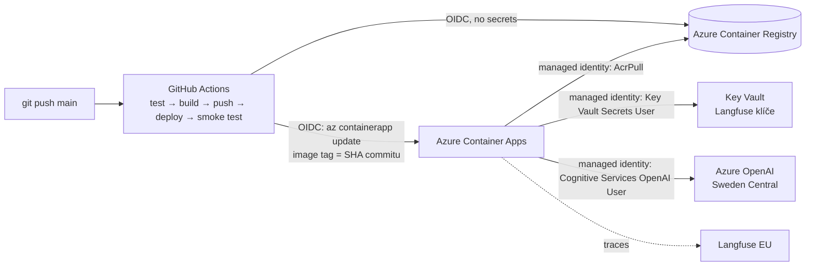

# DocAssist

RAG asistent pro HR, který odpovídá na otázky zaměstnanců z interních směrnic, cituje zdroj
a respektuje přístupová práva podle rolí.

**Stack:** Python 3.14 · LangGraph · FastAPI · ChromaDB · Azure OpenAI (gpt-4.1-mini, text-embedding-3-small) · Langfuse · Docker · Azure Container Apps · GitHub Actions

## Features

- **Odpovědi s citacemi**: každé tvrzení odkazuje na pasáž ze směrnice (`[1]`, `[2]`).
- **Role-based access v retrievalu**: `employee` vidí jen veřejné dokumenty, `hr` i personální, `management` vše. Filtr běží v databázi, ne v promptu.
- **Guardrails**: regex na známé prompt injection, router odmítá otázky mimo téma a útoky.
- **Agent s nástroji**: vyhledávání ve směrnicích, extrakce pravidel dovolené do struktury, shrnutí dokumentu.
- **Paměť konverzace**: `thread_id`, historie ořezaná na 4000 tokenů.
- **Evaluace**: golden set 20 otázek, LLM soudce + deterministické kontroly.
- **Tracing**: Langfuse (EU), zpětná vazba uživatelů jako skóre k trace.
- **Bez API klíčů**: managed identity + Key Vault, přepnutí OpenAI ↔ Azure OpenAI jednou proměnnou.
- **CI/CD**: testy → build → deploy → smoke test, přihlášení do Azure přes OIDC.

## Architecture



### Request flow
1. API ověří vstup (Pydantic) a roli z hlavičky `X-User-Role` → povolené úrovně přístupu (`all`, `hr`, `management`).
2. **Guardrails** ve třech vrstvách: regex na známé injekce, router, který odmítne otázky mimo téma a útoky, a system prompt, který bere obsah dokumentů jako data, ne jako pokyny. Druhou vrstvou je content filter Azure OpenAI.
   Přístupová práva ale neřeším promptem. Role z požadavku jde přes config do nástroje a Chroma vrací jen chunky s povolenou úrovní, takže model důvěrný dokument nikdy neuvidí.
   Při testování jsem zjistila, že rebuild indexu označil důvěrný dokument jako veřejný. Kód byl v pořádku, chyba byla v datech. Proto by v produkci úroveň přístupu musela být uložená u dokumentu, ne jen ve vektorové databázi.
3. **LangGraph workflow**: router rozhodne mezi `chitchat`, `refusal` a `agent`. Agent v cyklu volá nástroje (max. 3 kola, `RECURSION_LIMIT` 10), pak odpoví.
4. Agent volá `search_documents` s filtrem `access`. Výsledky pod prahem podobnosti zahodí a vrátí „Nic relevantního nenalezeno.“, takže se u otázek mimo dokument nezacyklí.
5. Odpověď obsahuje text s citacemi `[1]`, `thread_id`, použité nástroje a `trace_id`; hlavička `X-Request-ID` propojí požadavek s logy.

### Deployment (Azure)



Aplikace běží v **Azure Container Apps**: mám Docker image a potřebuju HTTPS adresu, škálování (i na nulu), managed identity a revize, ale bez správy Kubernetes (AKS). App Service by šlo také, Container Apps je ale přirozenější pro kontejner a umí scale-to-zero.
Aplikace má jednu **user-assigned managed identity** se třemi úzkými rolemi:

| role | na čem | k čemu |
|---|---|---|
| AcrPull | Container Registry | stáhnout image |
| Key Vault Secrets User | Key Vault | číst Langfuse klíče |
| Cognitive Services OpenAI User | Azure OpenAI | volat model bez API klíče |

Všechny prostředky jsou v regionu **Sweden Central**. Image se taguje **SHA commitu**, takže každá verze je jednoznačná a rollback znamená přepnout na starší revizi.

## Evaluation

Kvalitu RAG měřím evaluací nad **golden setem 20 otázek** s referenčními odpověďmi, které jsem napsala podle dokumentu (ne model). Kategorie: fakt, podmínka, výpočet, parafráze, úskalí a **mimo dokument**: u těch je halucinace nejdražší chyba.

- **Deterministické kontroly** (kód, zdarma, přesné): správný nástroj a formát citací.
- **LLM-as-judge** (gpt-4o, silnější model než hodnocený, temperature 0, structured output): nejdřív zdůvodnění, pak skóre 1–5 pro **relevance**, **groundedness** a **correctness**. Případ projde, když jsou všechna tři skóre ≥ 4 a obě deterministické kontroly jsou OK.

Soudce dal v prvním běhu plný počet bodů i chybové hlášce. Proto ho kalibruju proti vlastnímu hodnocení, chybové stavy hodnotím 1/1/1 bez soudce a kombinuju ho s deterministickými kontrolami.

| běh | model | pass rate | relevance | groundedness | correctness |
|---|---|---|---|---|---|
| první běh | OpenAI gpt-4o-mini | 0,45 | 4,2 | 4,6 | 4,5 |
| po opravě měření a ořezu historie | OpenAI gpt-4o-mini | 0,90 | 4,8 | 5,0 | 4,8 |
| po přepnutí na Azure | Azure gpt-4.1-mini | 0,85–0,90 | 4,8–4,9 | 4,9–5,0 | 4,8–4,9 |

**Co jsem díky tracingu opravila:** u složitějších otázek agent odpovídal „v dokumentech není“. Testy prošly, protože `FakeAgent` graf nespouští. Až vstup posledního volání LLM v Langfuse ukázal, že `trim_messages` ořezával i aktuální otázku s výsledky hledání, takže model dostal prázdný kontext. Teď se ořezává jen starší historie. Pass rate 0,8 → 0,9.

Soudce kolísá i při temperature 0, takže rozdíl 0,05 mezi běhy nic neznamená. Evaluace stojí peníze, proto neběží v CI, ale ručně po změně promptu, modelu, chunkingu nebo `TOP_K`.

```bash
python scripts/evaluate.py
```

## Security

**Co je hotové**
- **Žádné API klíče** v kódu ani v konfiguraci: aplikace se přihlašuje managed identity, Langfuse klíče jsou v Key Vaultu.
- **OIDC v CI/CD**: GitHub Actions se do Azure přihlašuje federovanou identitou jen pro větev `main`, v GitHubu není žádné heslo.
- **Least privilege**: identita aplikace má tři úzké role (viz výše).
- **Filtr přístupu v retrievalu**, ne v promptu: model důvěrný dokument nikdy nedostane.
- **Guardrails**: regex + router + system prompt, druhou vrstvou je content filter Azure.
- **Non-root kontejner**, healthcheck, limit velikosti uploadu (10 MB), ochrana proti path traversal v názvu souboru.
- **Logy bez obsahu**: request_id, cesta, status, čas a jméno zachyceného vzoru, ne text otázky ani hodnoty klíčů.
- **Langfuse v EU regionu.**

**Známá omezení**
- **Role z hlavičky jde podvrhnout**: `X-User-Role` může poslat kdokoli. V produkci role z JWT tokenu Entra ID.
- **Veřejný endpoint bez autentizace**: `/upload` zavolá každý, kdo zná URL a pošle správnou hlavičku.
- **GlobalStandard deployment** chatu = inference se může zpracovat mimo EU (na trialu jiná kvóta není). Pro klienta s GDPR `DataZoneStandard` (EU) nebo `Standard` v EU regionu.
- **Prompty a odpovědi v Langfuse** obsahují i důvěrné pasáže. V produkci maskování, self-hosted Langfuse ve vlastním tenantu, sampling a retence.
- Router loguje zdůvodnění od LLM, které může parafrázovat otázku → logovat jen rozhodnutí.

## Costs

**Proměnné náklady** (gpt-4.1-mini, měřeno na 10 otázkách z golden setu)

| | hodnota |
|---|---|
| tokeny na dotaz | ~4 570 vstup (z toho ~48 % z cache), ~160 výstup |
| poměr vstup:výstup | 29:1 |
| 1000 dotazů s prompt cache | ~$1,43 |
| 1000 dotazů bez cache | ~$2,09 |

**Fixní náklady** (měsíc)

| položka | cena |
|---|---|
| Container App (1 vCPU, 2 GiB, min 1 replika) | ~$22 |
| Container Registry Basic | ~$5 |
| Key Vault, Log Analytics | haléře |

Reálně naměřeno: ~$0,07/den v prvních dnech (měsíční grant zdarma).

**Tři páky**
1. **Prompt caching**: statické části promptu dopředu, proměnné na konec. V testu −72 % ceny volání. Platím hlavně za vstup (29:1), takže optimalizuju kontext, ne délku odpovědi.
2. **Right-sizing / scale-to-zero**: 0,5 vCPU / 1 GiB = poloviční cena (aplikace hlavně čeká na LLM). `min-replicas 0` = idle téměř zdarma, ale cold start a ztráta Chromy na disku (až s Azure AI Search).
3. **Menší kontext**: nižší `TOP_K`, kratší chunky a system prompt, levnější model na router.

```bash
python scripts/cost_per_query.py
```

## Limitations & next steps
- **Chroma na ephemeral disku** kontejneru: jedna replika a data se po restartu ztratí → Azure AI Search.
- **Autentizace přes Entra ID** místo role z hlavičky.
- **Úroveň přístupu uložená u dokumentu**, ne jen ve vektorové databázi (viz chyba při rebuildu indexu).
- **Chunkování po článcích** směrnice místo pevné délky (otázky q11, q20).
- **Kalibrace soudce**: vícenásobné hodnocení, přesnější rubrika, porovnání s člověkem.
- **DataZone EU** deployment pro chat.
- `PermissionDeniedError` z Azure OpenAI vracet jako 503 místo 500.

## Local development

1. **Virtuální prostředí:**
   ```powershell
   python -m venv venv
   .\venv\Scripts\Activate.ps1
   ```

2. **Závislosti:**
   ```bash
   pip install -e ".[dev]"
   ```

3. **Konfigurace v `.env`** v kořeni projektu. Hodnoty, které nejsou v prostředí, se načtou z Key Vaultu (přihlášení přes `az login`):
   ```env
   # Varianta OpenAI
   LLM_PROVIDER=openai
   OPENAI_API_KEY=sk-...

   # Varianta Azure OpenAI (bez API klíče, Entra ID)
   LLM_PROVIDER=azure
   AZURE_OPENAI_ENDPOINT=https://<resource>.openai.azure.com/
   AZURE_OPENAI_API_VERSION=2024-10-21
   AZURE_OPENAI_CHAT_DEPLOYMENT=chat
   AZURE_OPENAI_EMBEDDING_DEPLOYMENT=embedding

   # Volitelné
   KEY_VAULT_URL=https://<vault>.vault.azure.net/
   LANGFUSE_PUBLIC_KEY=pk-lf-...
   LANGFUSE_SECRET_KEY=sk-lf-...
   LANGFUSE_BASE_URL=https://cloud.langfuse.com
   ```
   Soudce v evaluaci běží vždy na OpenAI, takže pro `scripts/evaluate.py` je potřeba `OPENAI_API_KEY` i ve variantě Azure.

4. **Index dokumentů:**
   ```bash
   python scripts/build_index.py
   ```

### Run the API Server

```bash
uvicorn docassist.api.main:app --reload
```

Swagger dokumentace: `http://127.0.0.1:8000/docs`.

### API Endpoints

- `GET /health`: health check (`{"status": "ok"}`).
- `POST /ask`: otázka (`{"question": "...", "thread_id": "..."}`), role v hlavičce `X-User-Role` (`employee` | `hr` | `management`, výchozí `employee`).
- `POST /upload`: nahraje `.pdf` do `data/` a zaindexuje ho; jen role `hr` a `management`.
- `POST /feedback`: hodnocení odpovědi od uživatele, uloží se jako skóre k trace v Langfuse.

### Tests

```bash
pytest
```
Testy nevolají žádné API: agenta nahrazuje `FakeAgent` a Key Vault falešný klient.

## Docker

```bash
docker build -t docassist:0.1 .
docker run --rm -p 8000:8000 --env-file .env -v ${PWD}/data:/app/data --name docassist docassist:0.1
```

## Project structure

```text
src/docassist/
├── agent/            # LangGraph agent, nástroje, prompty, cache zpracování PDF
├── api/              # FastAPI app, schémata, error handlery
├── db/               # embeddingy a ChromaDB vector store
├── eval/             # LLM soudce
├── extract/          # extrakce pravidel do struktury (Pydantic)
├── ingest/           # načtení PDF, chunking, indexace
├── rag/              # formátování kontextu a prompty
├── config.py         # centrální konfigurace
├── guardrails.py     # prompt injection, role → úrovně přístupu
├── llm.py            # továrna na klienty (OpenAI / Azure OpenAI)
├── observability.py  # nastavení Langfuse
└── secret_store.py   # načtení tajemství z prostředí / Key Vaultu
scripts/              # build_index, ask, chat, evaluate, cost_per_query, prompt_cache_demo
eval/                 # golden set a výsledky běhů
tests/                # unit a API testy (pytest)
```
